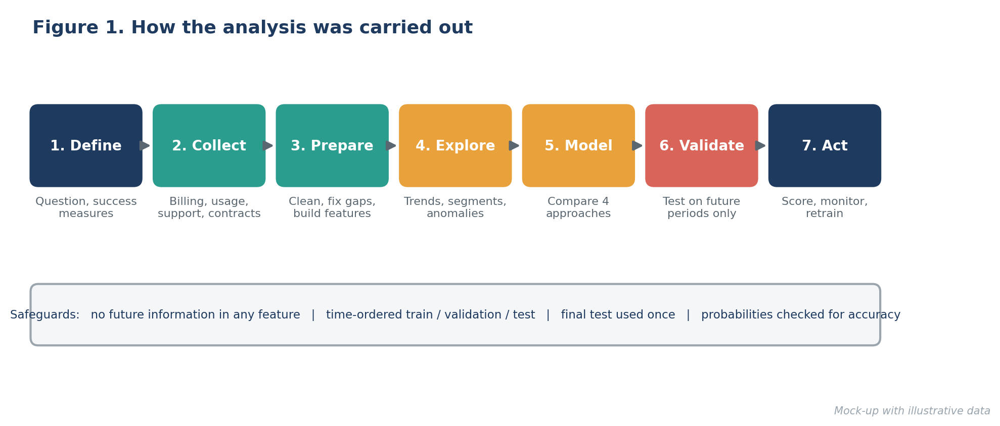
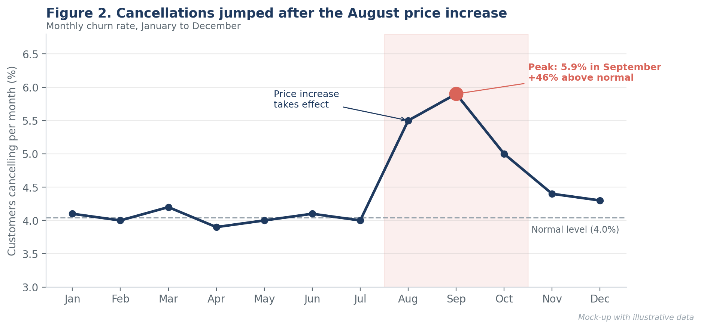
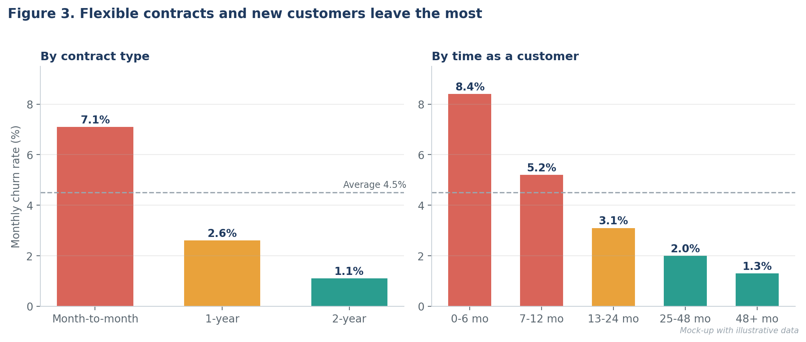
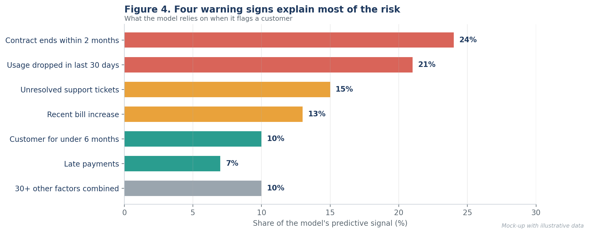
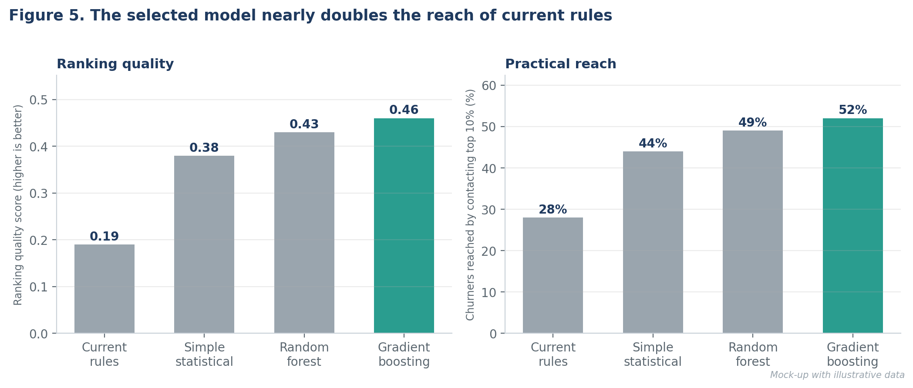
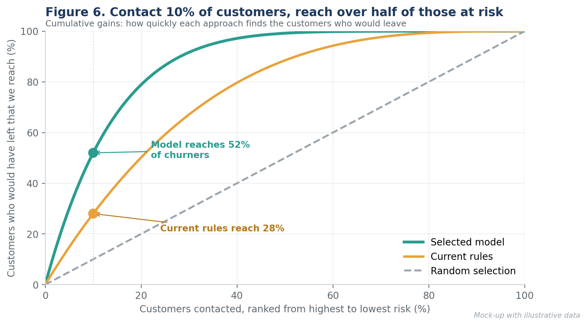
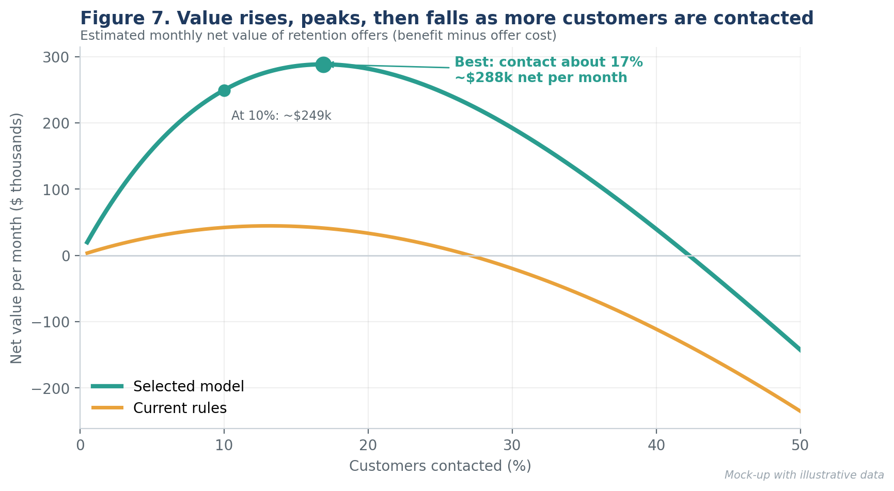
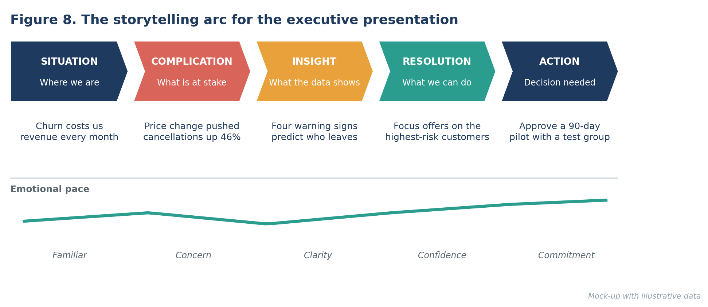
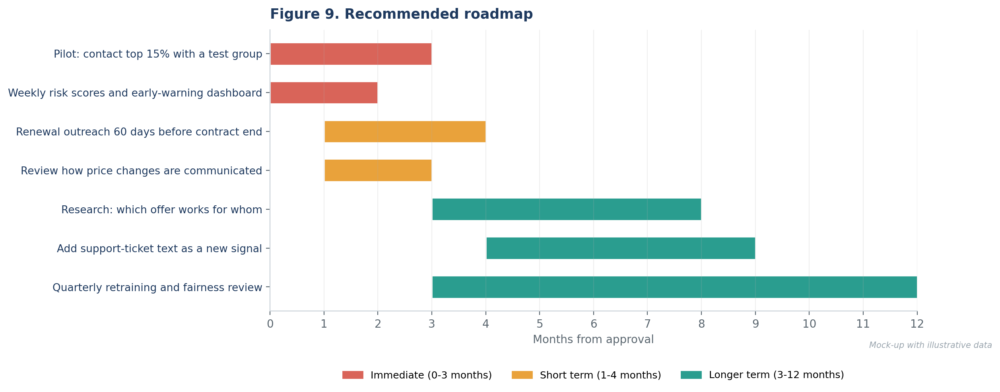

# Reducing Customer Churn with Data Science: Report and Presentation Plan

Week 4 deliverable: a comprehensive data science report and an insights presentation plan for a
**hypothetical** subscription business with about 400,000 active customers.

> All results, charts and dollar values are illustrative mock-ups created to show how findings would be
> analysed, visualized and communicated. They are not real data.

Full report: [`docs/Week4_Final_Report_and_Presentation_Plan.docx`](docs/Week4_Final_Report_and_Presentation_Plan.docx)

## Headline findings (illustrative)
- Churn is concentrated: month-to-month contracts churn at 7.1% per month vs 1.1% for two-year contracts
- The August price increase pushed monthly churn up by 46% at its peak
- Four warning signs explain about 73% of the model's signal
- Contacting the top 10% of customers reaches 52% of those who would leave (current rules: 28%)
- Estimated uplift of about $2.5M a year, to be confirmed with a 90-day pilot and control group

## What the report covers
1. Executive summary
2. Background and objectives
3. Methodology overview
4. Findings and insights
5. Visualization plan and rationale
6. Actionable insights
7. Presentation strategy for a non-technical audience (storytelling arc, slide plan, sample narrative, Q&A)
8. Recommendations and future work
9. Production plan, conclusion and glossary

## Selected visuals










## Repository structure
```
docs/     final report (Word)
images/   mock-up visualizations
```

## Status
Final report and presentation plan complete (Week 4).
